# Timer screenshots

Generated by `npm run screenshots` (part of `npm test`) using the local
playground with mocks, fixed time and the version label hidden. Do not edit manually;
add new states to [tests/screenshots.visual.cjs](../../tests/screenshots.visual.cjs).
PR diffs show visual changes; file history and release tags preserve earlier versions.

## Timer states

| State | Screenshot |
| --- | --- |
| Idle (red) (`idle`) |  |
| Tracking the open issue (green) (`running`) | 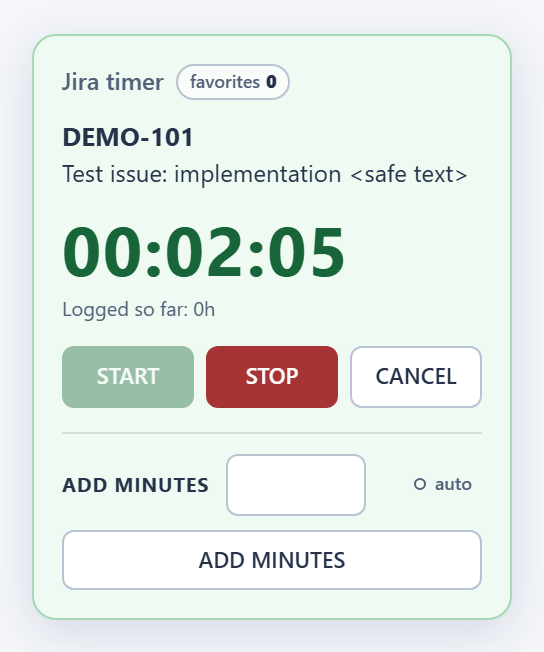 |
| Tracking another issue (blue) (`running-other-issue`) | 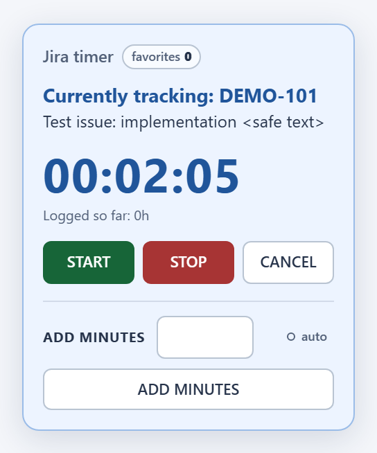 |
| No open issue (`no-open-issue`) | 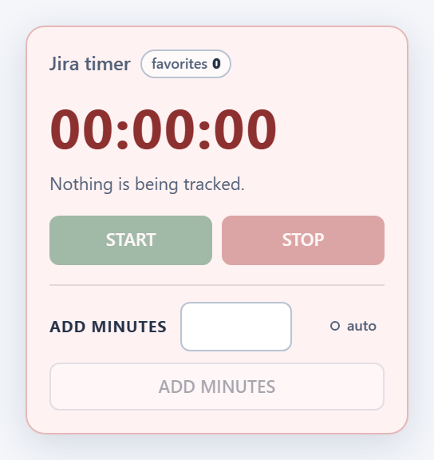 |
| STOP: saved work log and toast (`saved-toast`) |  |
| CANCEL: discarded timer and toast (`discarded-toast`) | 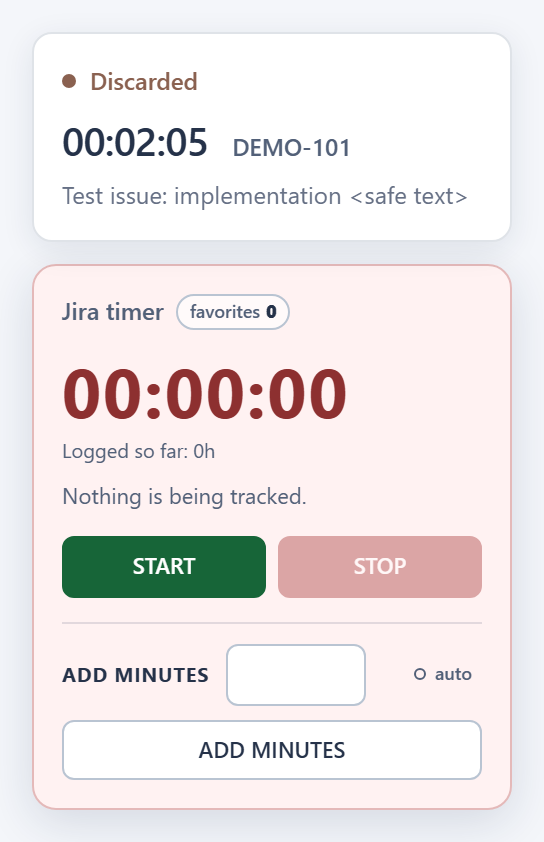 |
| Save failure: manual retry (`save-failed`) | 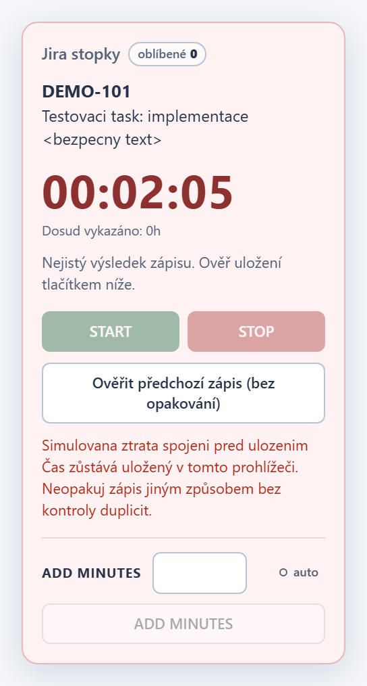 |
| Lost response: verify marker (`save-uncertain`) | 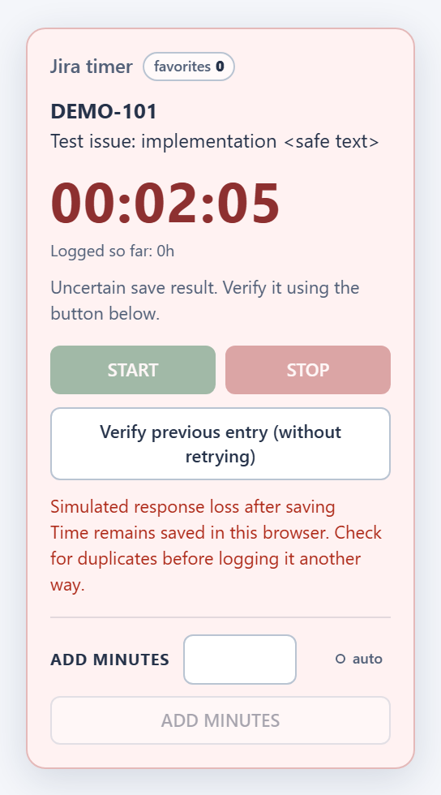 |

## Work log totals

| State | Screenshot |
| --- | --- |
| Personal total including subtasks (`totals-with-subtasks`) |  |
| Failed to load totals (`totals-error`) | 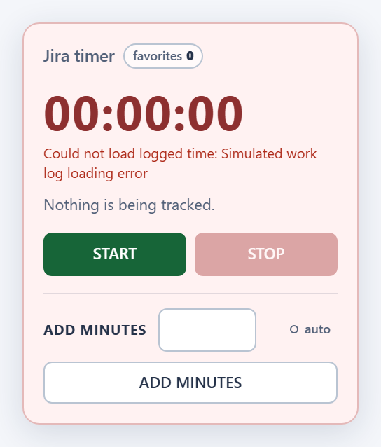 |
| Loading totals before Jira responds (`totals-loading`) | 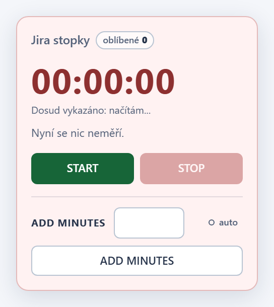 |

## ADD MINUTES and AUTO

| State | Screenshot |
| --- | --- |
| ADD MINUTES: manual entry of 15 minutes (`manual-saved`) |  |
| ADD MINUTES: invalid value (`manual-invalid`) | 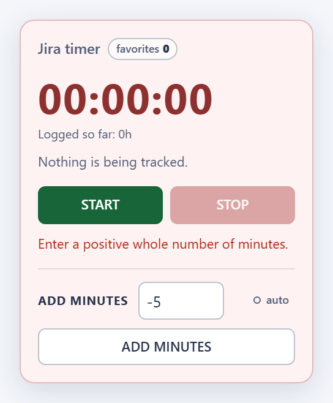 |
| ADD MINUTES: zero minutes logs nothing (`manual-zero`) | 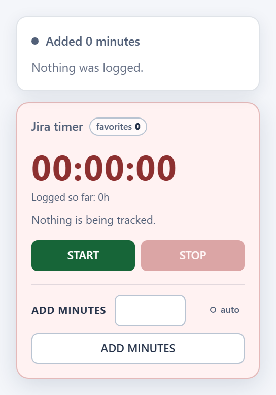 |
| AUTO enabled: panel indicator (`auto-enabled`) | 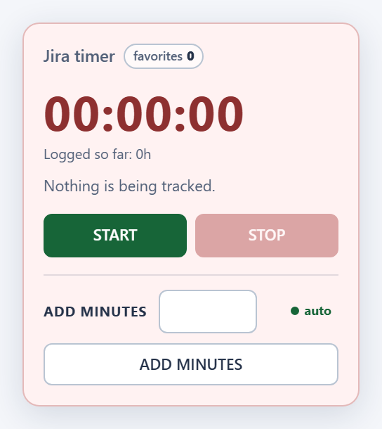 |
| AUTO: corrupted settings indicator (`auto-settings-error`) | 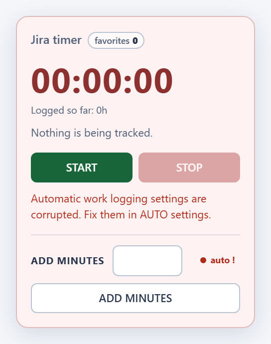 |
| AUTO: automatic work logging settings (`auto-settings`) | 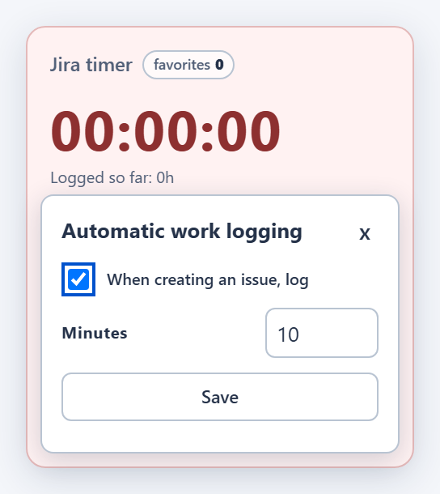 |
| AUTO: work log on Sub-task Bug creation (`auto-worklog`) | 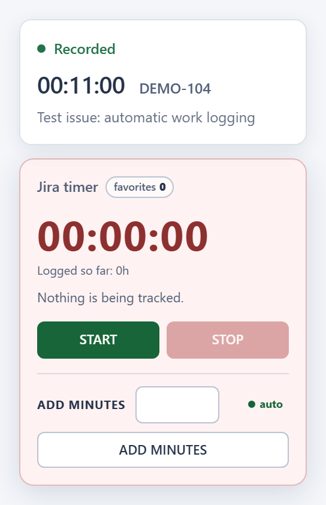 |

## Favorites

| State | Screenshot |
| --- | --- |
| Favorites chip with count (`favorites-chip`) | 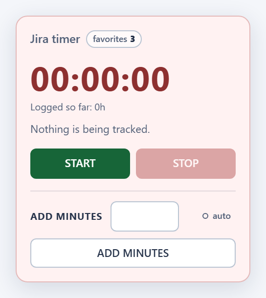 |
| Favorites open above the timer (`favorites-open`) |  |
| Favorite issue menu (`favorites-menu`) | 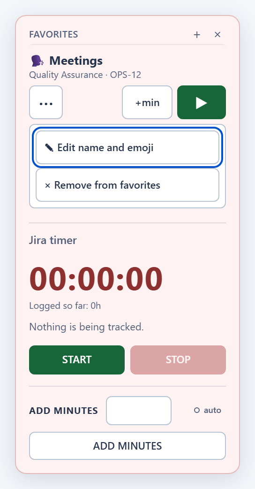 |
| Edit custom name and emoji (`favorites-rename`) | 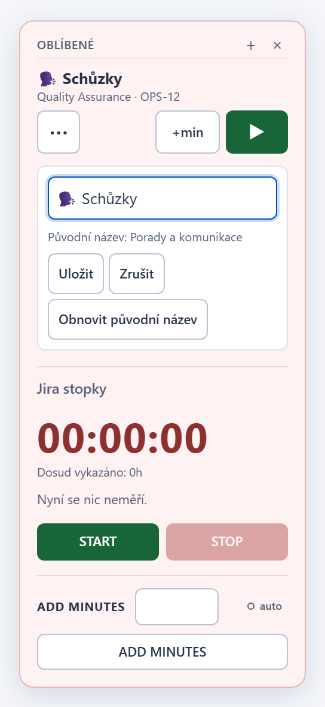 |
| Search: new-tab link and + adds (`favorites-search`) | 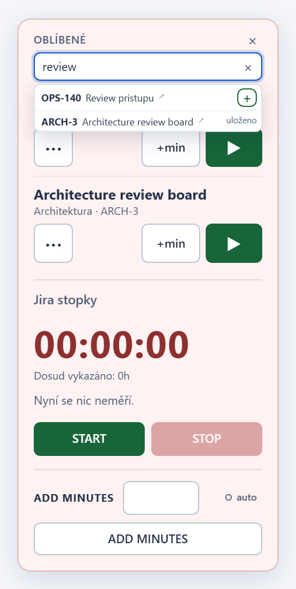 |
| +min on a favorite issue (`favorites-minutes`) | 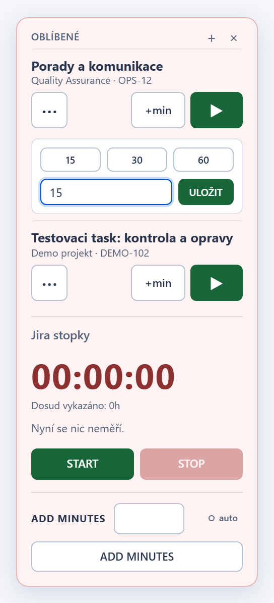 |
| Running favorite: stop instead of start (`favorites-running`) | 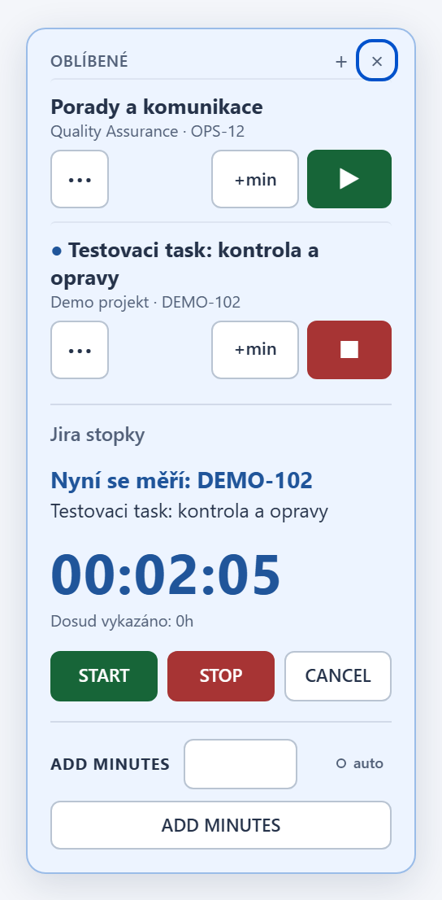 |
| Full list: search disabled (`favorites-limit`) | 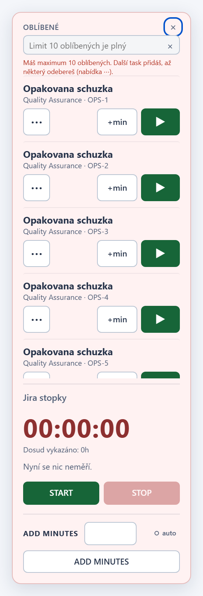 |

## State protection

| State | Screenshot |
| --- | --- |
| Lock held by another tab (`lock-busy`) | 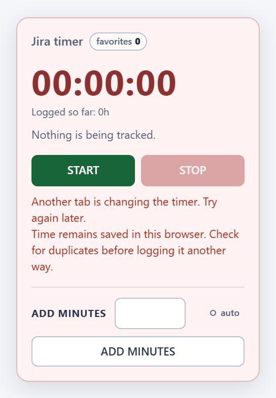 |
| Corrupted saved state (`corrupted-state`) | 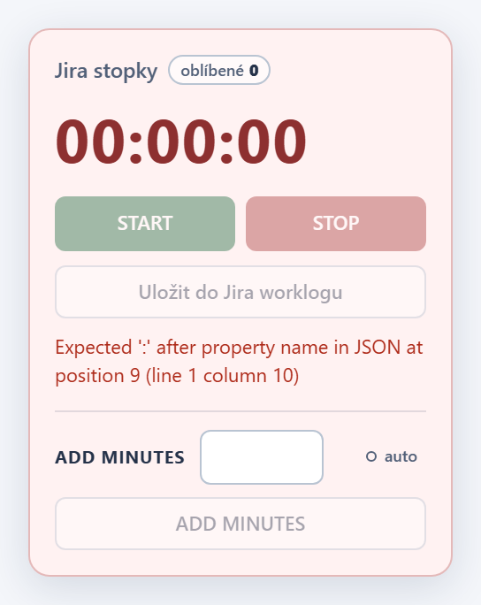 |
