# Screenshoty stopek

Generovano prikazem `npm run screenshots` (soucast `npm test`) z lokalniho
playgroundu s mocky, pevnym casem a skrytym cislem verze. Needitovat rucne;
nove stavy pridej do [tests/screenshots.visual.cjs](../../tests/screenshots.visual.cjs).
Zmeny vzhledu ukazuje diff PR, starsi podoby historie souboru a Git tagy vydani.

## Stavy pocitadla

| Stav | Screenshot |
| --- | --- |
| Nic se nemeri (cervena) (`idle`) | 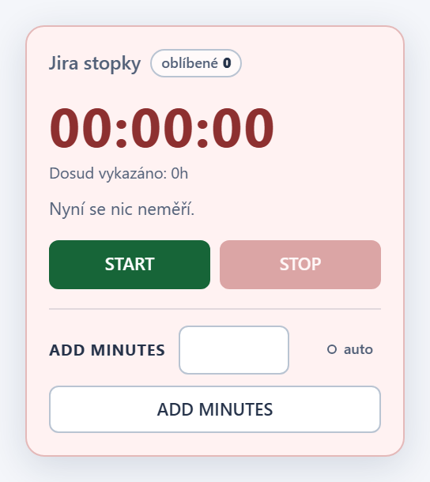 |
| Mereni otevreneho tasku (zelena) (`running`) | 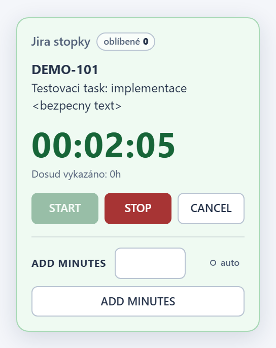 |
| Mereni jineho tasku (modra) (`running-other-issue`) | 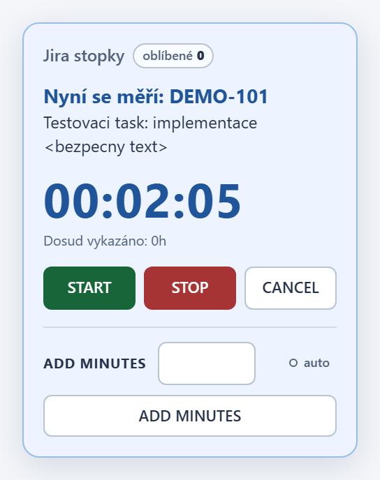 |
| Stranka bez otevreneho tasku (`no-open-issue`) | 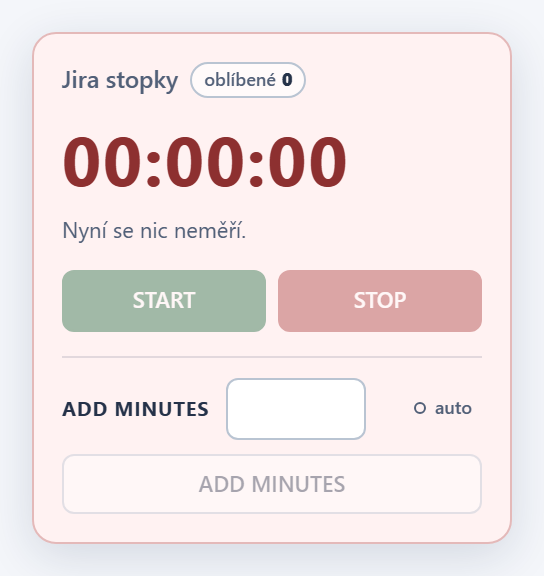 |
| STOP: ulozeny worklog a toast (`saved-toast`) | 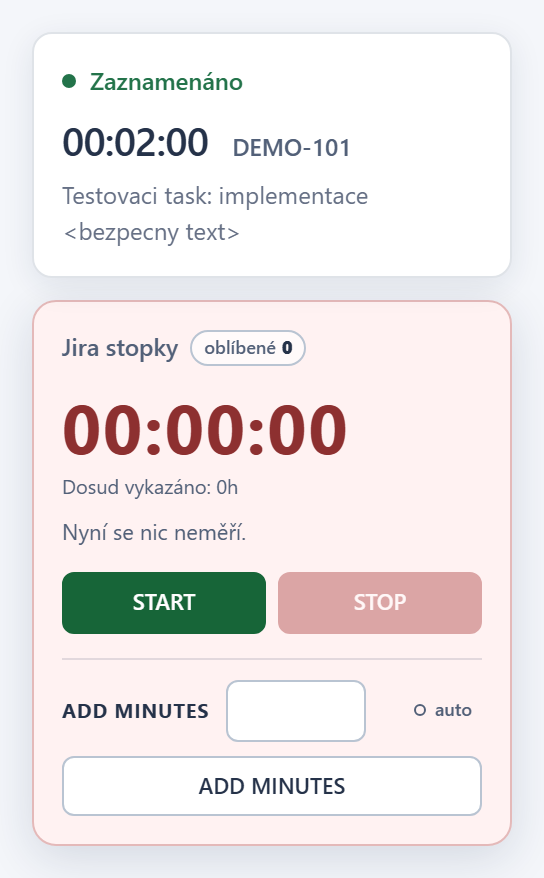 |
| CANCEL: zahozene mereni a toast (`discarded-toast`) | 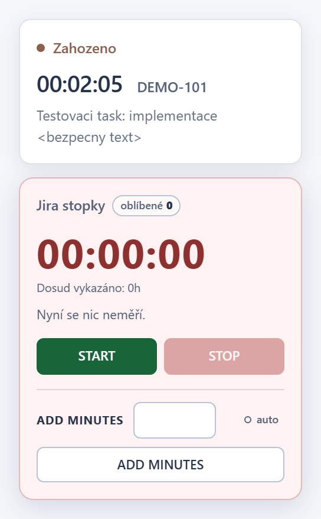 |
| Chyba pred ulozenim: rucni opakovani (`save-failed`) | 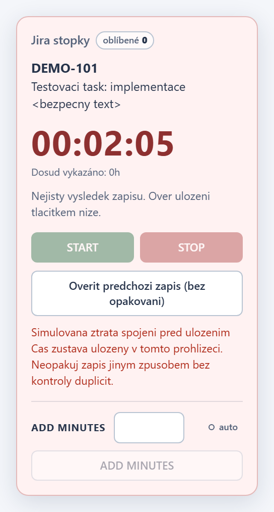 |
| Ztracena odpoved: overeni markeru (`save-uncertain`) | 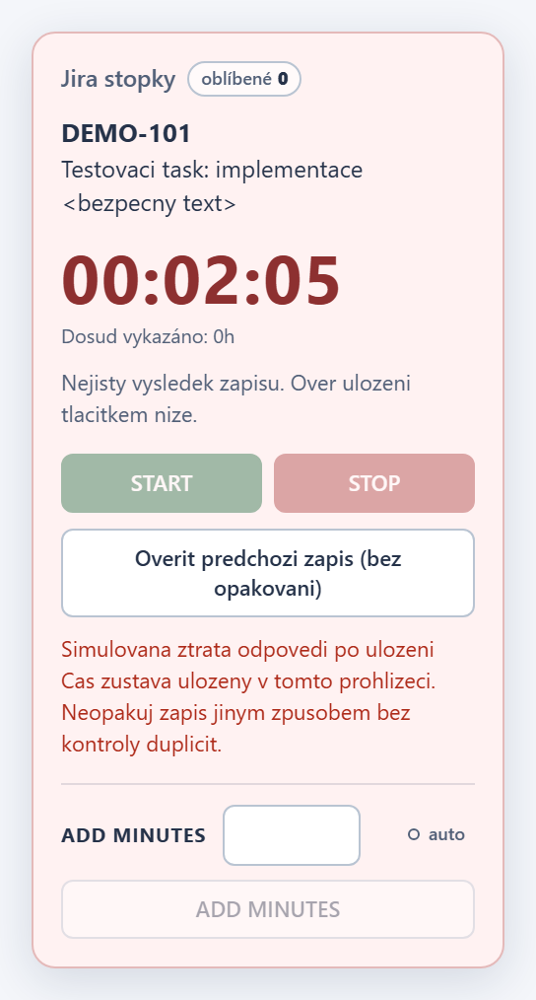 |

## Soucty worklogu

| Stav | Screenshot |
| --- | --- |
| Vlastni soucet vcetne subtasku (`totals-with-subtasks`) |  |
| Chyba nacteni souctu (`totals-error`) | 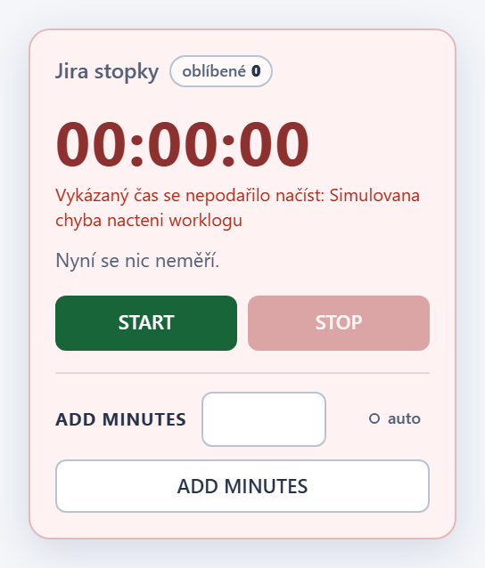 |

## ADD MINUTES a AUTO

| Stav | Screenshot |
| --- | --- |
| ADD MINUTES: rucni zapis 15 minut (`manual-saved`) | 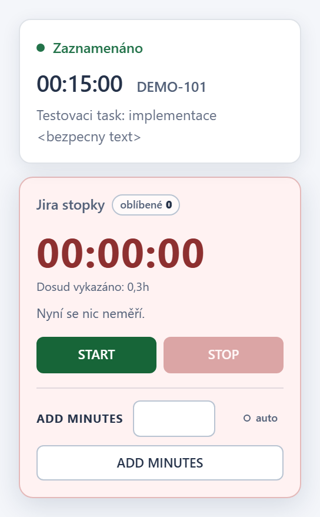 |
| ADD MINUTES: neplatna hodnota (`manual-invalid`) |  |
| AUTO zapnuto: indikator v panelu (`auto-enabled`) |  |
| AUTO: poskozene nastaveni v panelu (`auto-settings-error`) | 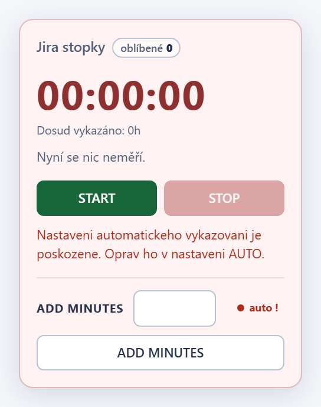 |
| AUTO: nastaveni automatickeho vykazovani (`auto-settings`) | 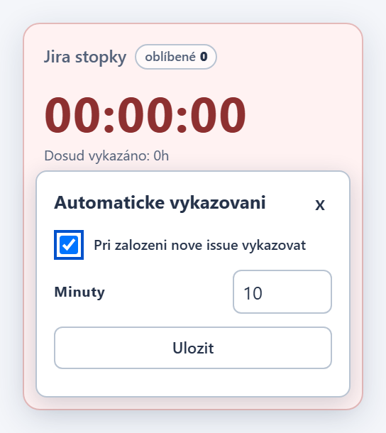 |
| AUTO: vykazani pri zalozeni Sub-task Bugu (`auto-worklog`) | 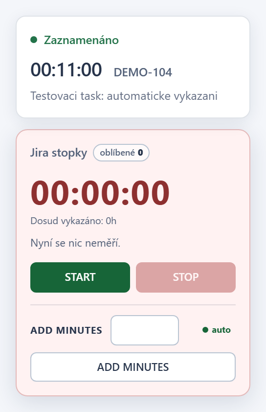 |

## Oblibene tasky

| Stav | Screenshot |
| --- | --- |
| Stitek oblibene s poctem (`favorites-chip`) | 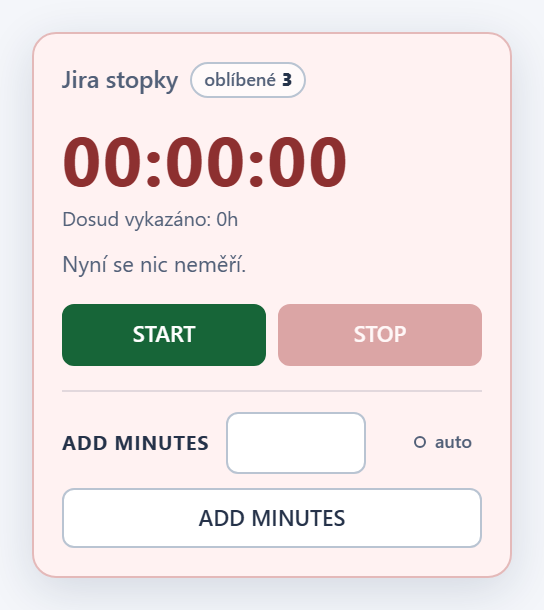 |
| Otevrene oblibene nad stopkami (`favorites-open`) | 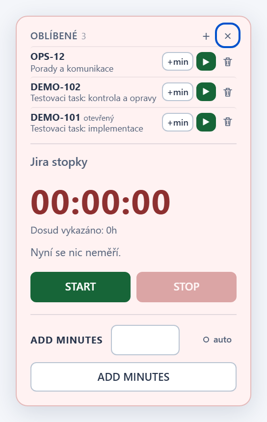 |
| Naseptavac: odkaz do nove karty, + prida (`favorites-search`) | 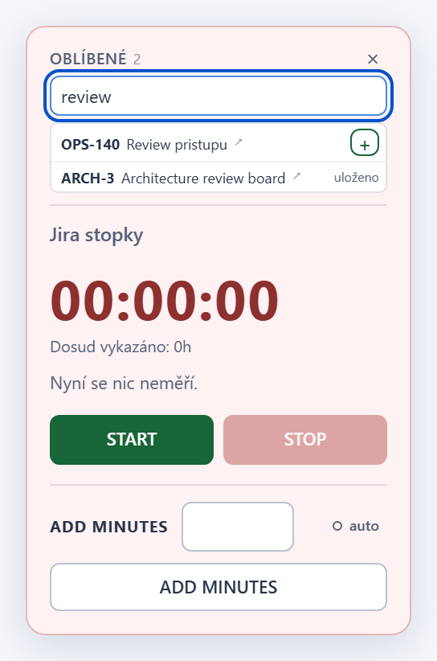 |
| +min do oblibeneho tasku (`favorites-minutes`) | 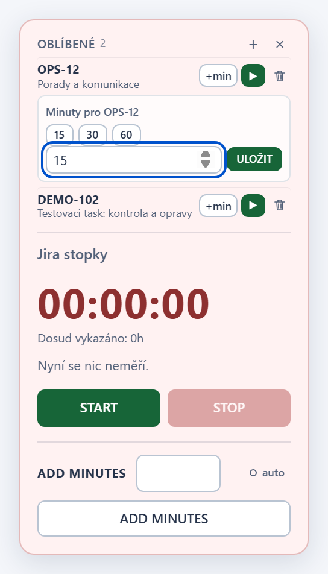 |
| Bezici oblibeny task: stop misto startu (`favorites-running`) | 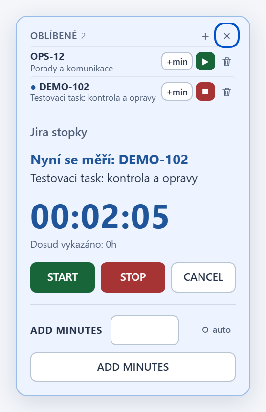 |
| Plny seznam: hledani je zablokovane (`favorites-limit`) | 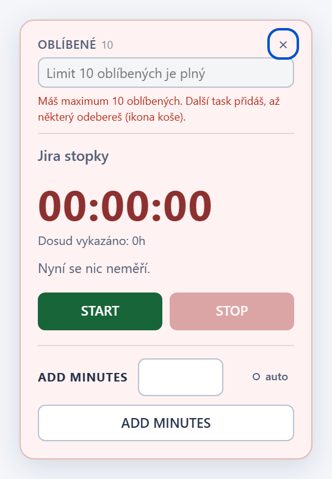 |

## Ochrana stavu

| Stav | Screenshot |
| --- | --- |
| Zamek drzi jina karta (`lock-busy`) | 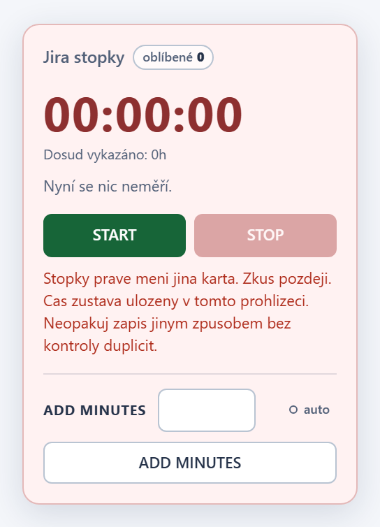 |
| Poskozeny ulozeny stav (`corrupted-state`) | 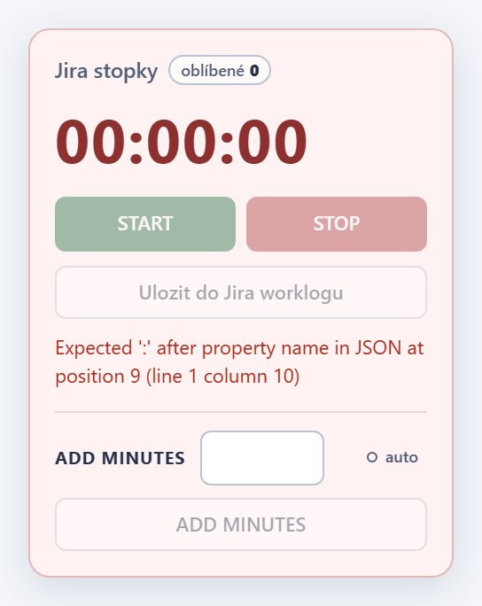 |
