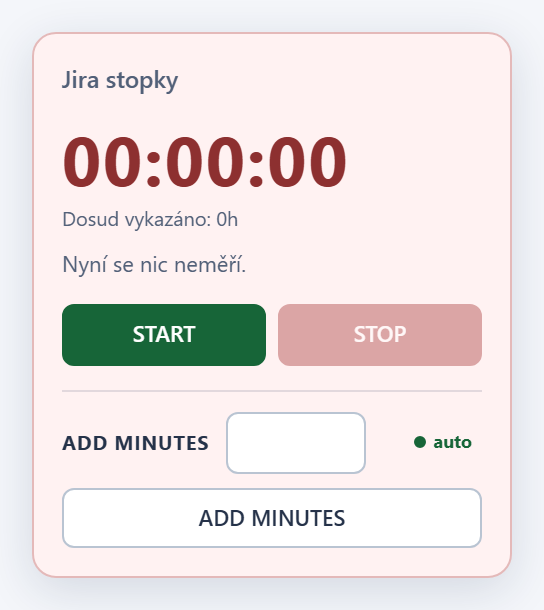
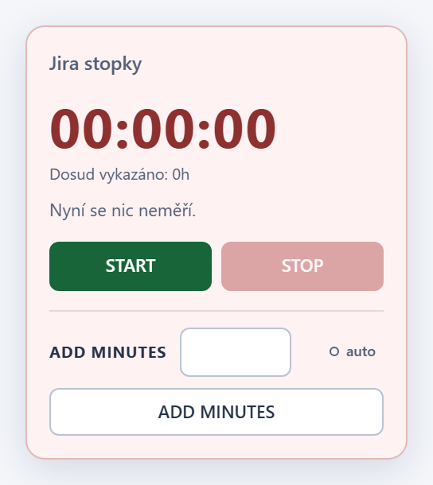
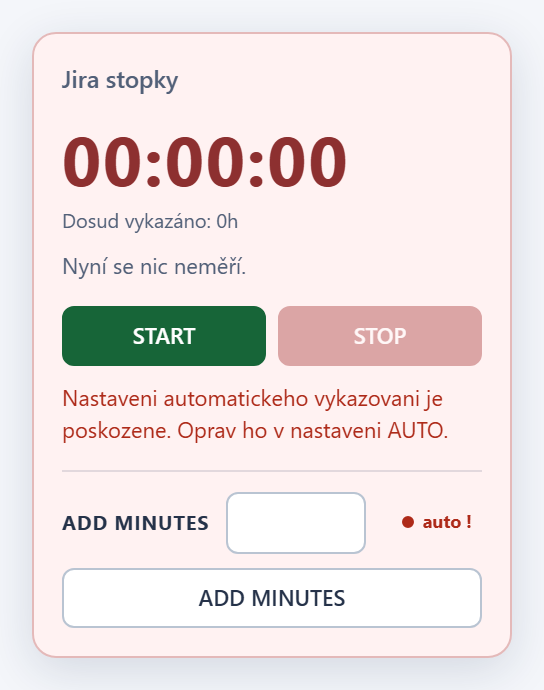

# Jira Local Workspace - Worklog timer v1.17.4

## Changes

- Stav automatickeho vykazovani (AUTO) je videt primo v panelu bez otevreni
  nastaveni (#25). Zapnute AUTO je zelene tucne s plnou zelenou teckou,
  vypnute sede s prazdnym krouzkem. Rozlozeni radku ADD MINUTES se nemeni;
  nastaveny pocet minut ukaze tooltip.
- Poskozene nastaveni AUTO se v panelu zobrazi cervene jako `auto !`, aby
  nevypadalo jako bezne vypnuty stav. Po ulozeni platneho nastaveni se
  indikator obnovi.
- Tooltip a popis pro ctecky obrazovky uvadi stav i pocet minut. Chovani
  AUTO a ukladani worklogu zustavaji beze zmeny.

## Screenshots

## Installation / update

Tampermonkey nacita aktualizace z vetve `main`. Po aktualizaci na 1.17.4
obnov stranku Jiry. Neinstaluj druhou kopii skriptu a nemaz data webu;
stav mereni i nastaveni AUTO zustavaji zachovany.

## Verification

`npm test`: uspesne kontroly syntaxe, Node regrese, kontroly vydani,
bezpecnostni audit, vsechny Chromium regrese s lokalnimi mocky a
regenerace screenshotu. Nove testy overuji indikator pro vychozi vypnuty
stav, zapnuti a vypnuti, zahozeni neulozenych zmen, nacteni ulozenych minut
v popisu tlacitka a poskozene nastaveni. Testy nekontaktuji skutecnou Jiru.
