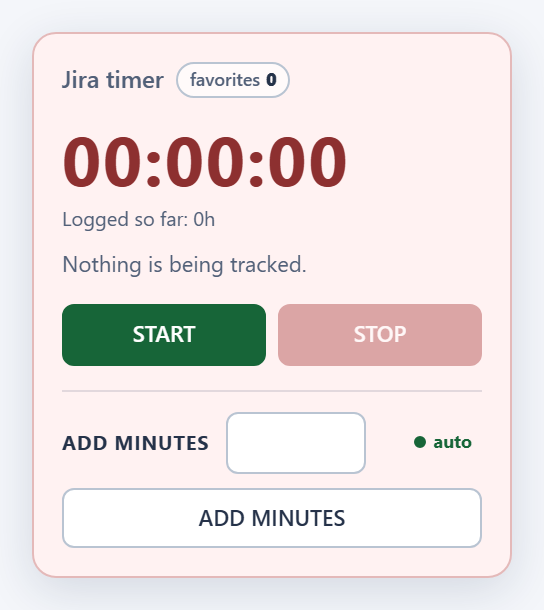
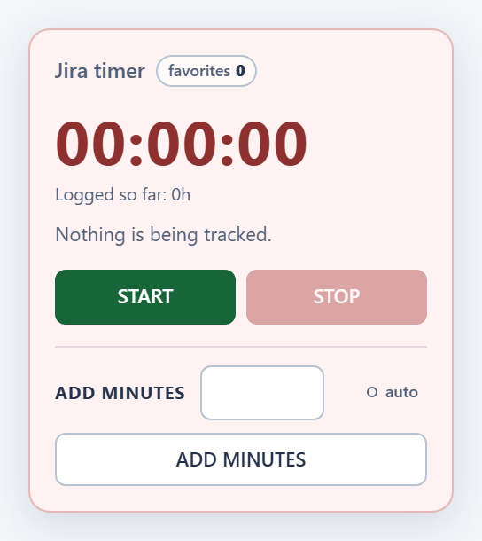
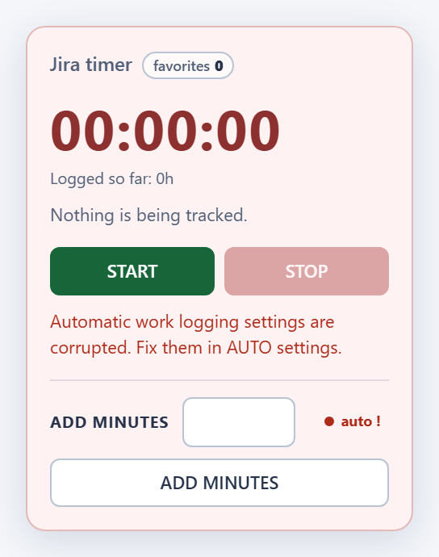

# Jira Local Workspace - Worklog timer v1.17.4

## Changes

- The AUTO state is visible in the panel without opening settings (#25). Enabled AUTO is bold green with a filled dot; disabled is gray with a hollow dot. The ADD MINUTES row layout is unchanged and the tooltip shows minutes.
- Corrupted AUTO settings appear as red `auto !`, not an ordinary off state. Saving valid settings restores the indicator.
- The tooltip and accessible label report state and minutes. AUTO and work log behavior are unchanged.

## Screenshots

## Installation / update

Tampermonkey loads updates from `main`. After updating to 1.17.4, refresh Jira. Do not install a second copy or clear site data; existing timer state is preserved.

## Verification

`npm test` passed: syntax, Node regressions, release checks, security audit, all Chromium regressions with local mocks and screenshot generation. New tests cover the default off state, enabling and disabling, discarding changes, saved minutes in the button description and corrupted settings. No live Jira is contacted.
