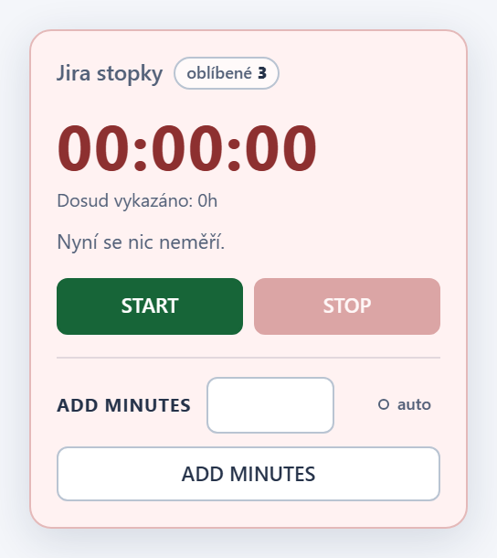
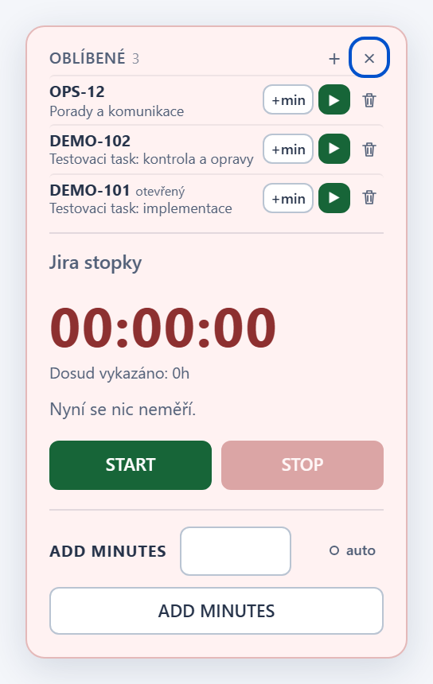
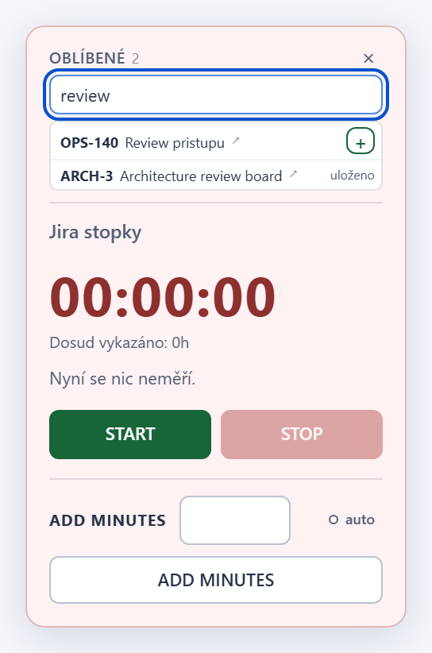
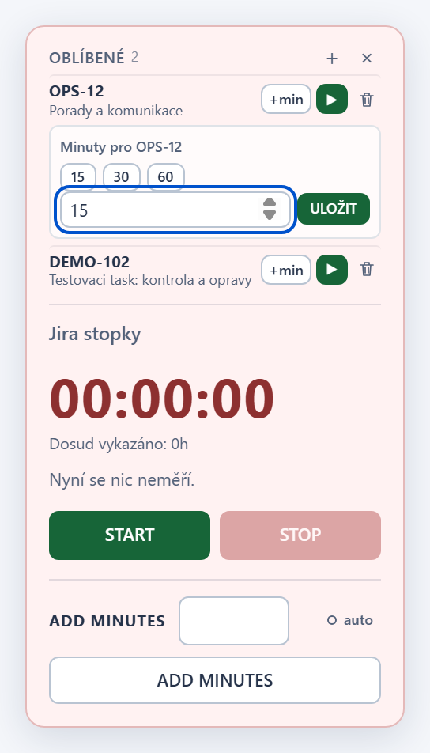
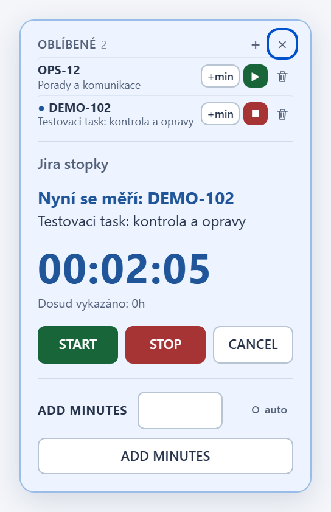
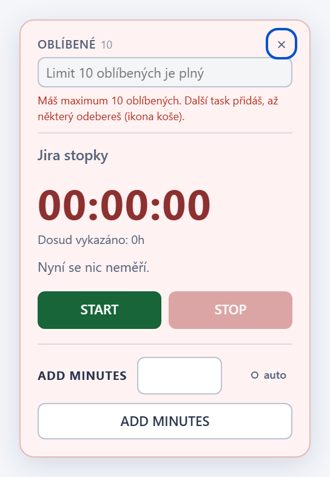

# Jira Local Workspace - Worklog timer v1.18.0

## Changes

- Oblibene tasky: vedle nadpisu "Jira stopky" je stitek `oblibene N`.
  Klik otevre kompaktni seznam primo nad stopkami (stitek se mezitim
  skryje), krizek ho zavre.
- Kazdy oblibeny task ma `+min` (rychle volby 15/30/60 jen predvyplni,
  zapis az po ULOZIT), `▶` pro spusteni stopek a ikonu kose pro odebrani.
  Bezici task ma modrou tecku a `■` pro zastaveni, otevreny task popisek
  "otevreny".
- `▶` funguje i pro task, ktery neni otevreny: bezici mereni se nejdriv
  ulozi a nove navaze na jeho konec. Po uspesnem spusteni se oblibene
  plynule zavrou (bez animace pri `prefers-reduced-motion`); pri chybe
  zustanou otevrene a chyba je videt.
- `+` v hlavicce otevre naseptavac (Jira issue picker, od 2 znaku).
  Klik na nazev vysledku otevre task v nove karte a nic neuklada; jen `+`
  u vysledku task prida, vyprazdni pole i vysledky a novy task kratce
  zvyrazni. Uz ulozene tasky maji popisek "ulozeno".
- Limit je 10 oblibenych. Pri plnem seznamu je pole naseptavace
  zablokovane a pod nim je vysvetleni, ze je nutne nejaky task odebrat.
- Seznam se uklada do `localStorage` (`jira-direct-timer-favorites-v1`) a
  sdili se mezi kartami. Poskozeny seznam se nemaze ani neprepisuje;
  stitek ukaze `!` a chyba je videt po otevreni.

## Screenshots

## Installation / update

Tampermonkey nacita aktualizace z vetve `main`. Po aktualizaci na 1.18.0
obnov stranku Jiry. Neinstaluj druhou kopii skriptu a nemaz data webu;
stav mereni i nastaveni AUTO zustavaji zachovany. Oblibene zacinaji
prazdne.

## Verification

`npm test`: uspesne kontroly syntaxe, Node regrese, kontroly vydani,
bezpecnostni audit, vsechny Chromium regrese s lokalnimi mocky a
regenerace screenshotu. Nove testy overuji stitek a otevreni, hledani
(minimalni delka, zahozeni zastaralych odpovedi, chyba a neplatna odpoved
Jiry), odkaz do nove karty bez ulozeni, pridani a odebrani, spusteni s
prepnutim bezicich stopek a plynulym zavrenim, zastaveni, chybu pri
spusteni, `+min` bez zmeny bezicich stopek, synchronizaci mezi kartami,
poskozeny seznam a limit. Format odpovedi Jira issue pickeru je overen jen
proti mocku, ne proti skutecne Jire.
