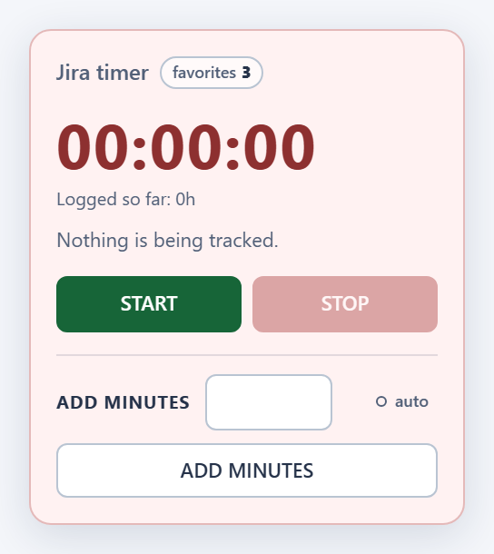
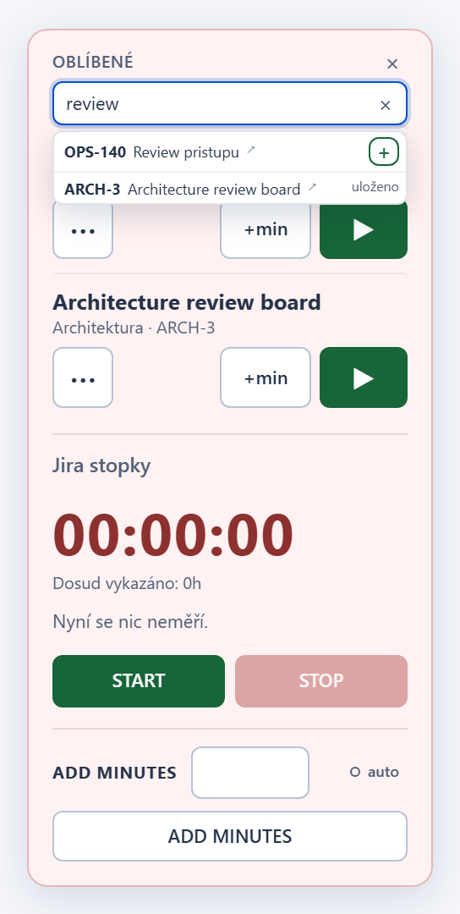
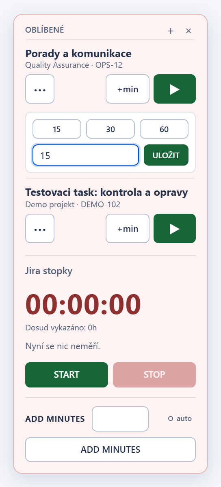
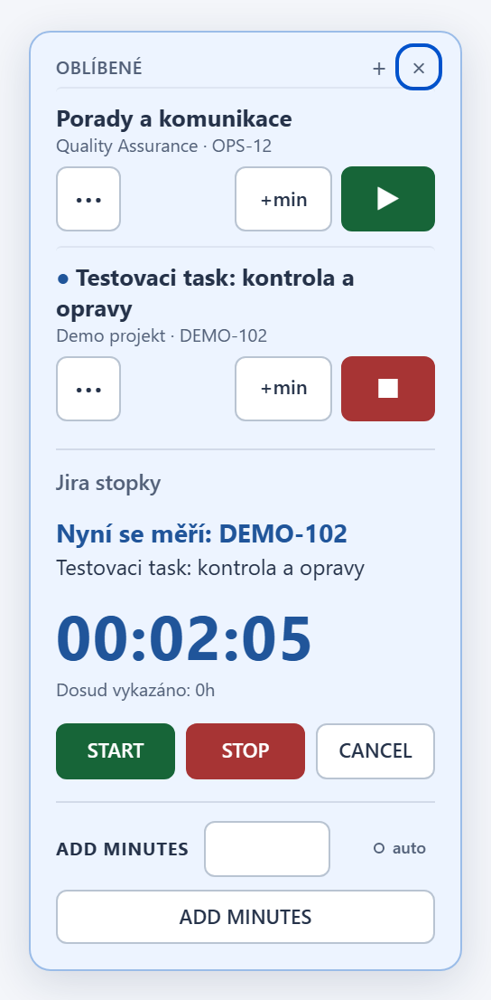
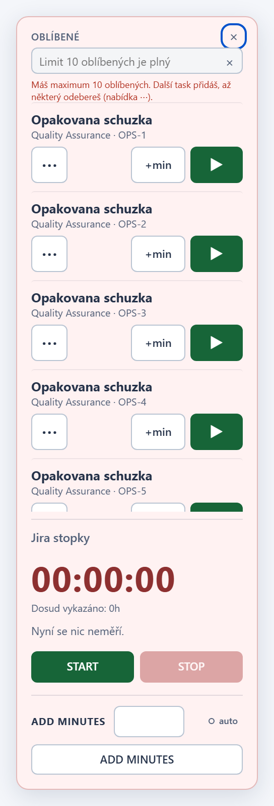

# Jira Local Workspace - Worklog timer v1.18.0

## Changes

- Added a favorites chip with a count beside the heading. It opens a compact list above the timer and hides until the list is closed.
- Each favorite has `+min` (15/30/60 prefill only; Save writes), `▶` to start, and a remove icon. A running issue has a blue dot and `■` to stop; the open issue was labeled.
- Starting a non-open favorite saves the running timer first and continues at its end time. The list closes smoothly on success (immediately with reduced motion); on failure it stays open with the error.
- The header `+` opens the Jira issue picker after two characters. Clicking a result opens a new tab without saving; its `+` adds it, clears search and briefly highlights it. Saved results are labeled.
- The limit is 10; search is disabled with an explanation when full.
- Favorites are stored in `localStorage` (`jira-direct-timer-favorites-v1`) and shared across tabs. A corrupted list is never deleted or overwritten; the chip shows `!` and the error appears on opening.

## Screenshots

## Installation / update

Tampermonkey loads updates from `main`. After updating to 1.18.0, refresh Jira. Do not install a second copy or clear site data; existing timer state is preserved. Favorites start empty.

## Verification

`npm test` passed: syntax, Node regressions, release checks, security audit, all Chromium regressions with local mocks and screenshot generation. New tests cover opening, search and its failures, result links, adding and removing, switching, closing, stopping, start failure, +min, cross-tab synchronization, corrupted storage and the limit. The Jira picker response shape was verified against mocks only, not live Jira.
