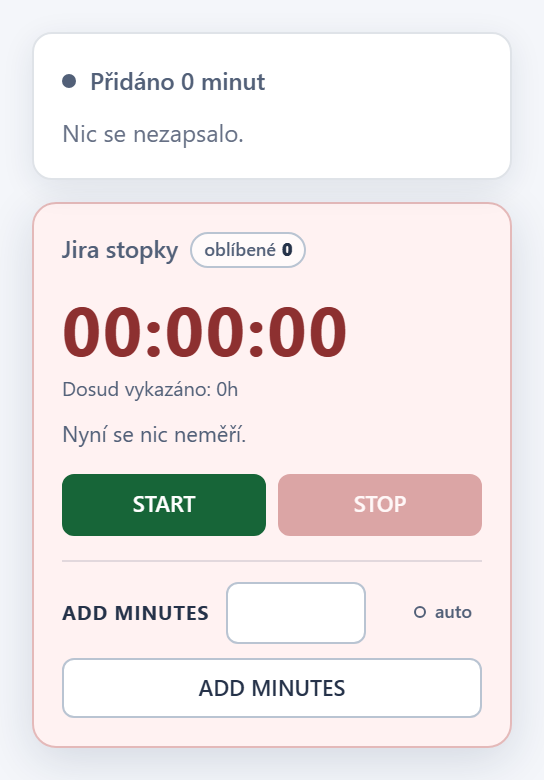
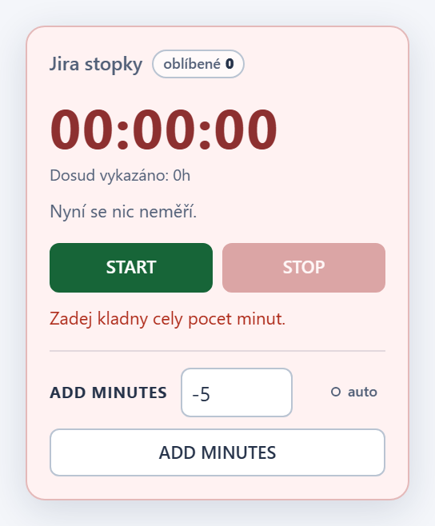

# Jira Local Workspace - Worklog timer v1.18.1

## Changes

- `0` nebo prazdne pole v ADD MINUTES i v `+min` u Oblibenych uz neni
  chyba: nic se nezapise do Jiry, bezici stopky zustanou beze zmeny a
  zobrazi se kratky toast "Pridano 0 minut - Nic se nezapsalo". Pole se
  vycisti a editor `+min` se zavre.
- Opravdu neplatne hodnoty (zaporne, desetinne, text) dal hlasi
  "Zadej kladny cely pocet minut.", ale uz bez varovani o duplicitnich
  zapisech, ktere patri jen k chybam pri ukladani.

## Screenshots

## Installation / update

Tampermonkey nacita aktualizace z vetve `main`. Po aktualizaci na 1.18.1
obnov stranku Jiry. Neinstaluj druhou kopii skriptu a nemaz data webu;
stav mereni, nastaveni AUTO i oblibene zustavaji zachovany.

## Verification

`npm test`: uspesne kontroly syntaxe, Node regrese, kontroly vydani,
bezpecnostni audit, vsechny Chromium regrese s lokalnimi mocky a
regenerace screenshotu. Nove testy overuji `0`, `00` a prazdne pole v
ADD MINUTES (tlacitko i Enter) i v `+min` u Oblibenych: zadny POST, zadna
chyba, toast, vycistene pole, zavreny editor a nezmenene bezici stopky.
Text v ciselnem poli, zaporne, desetinne a prilis velke hodnoty dal hlasi
chybu bez varovani o duplicitach.
