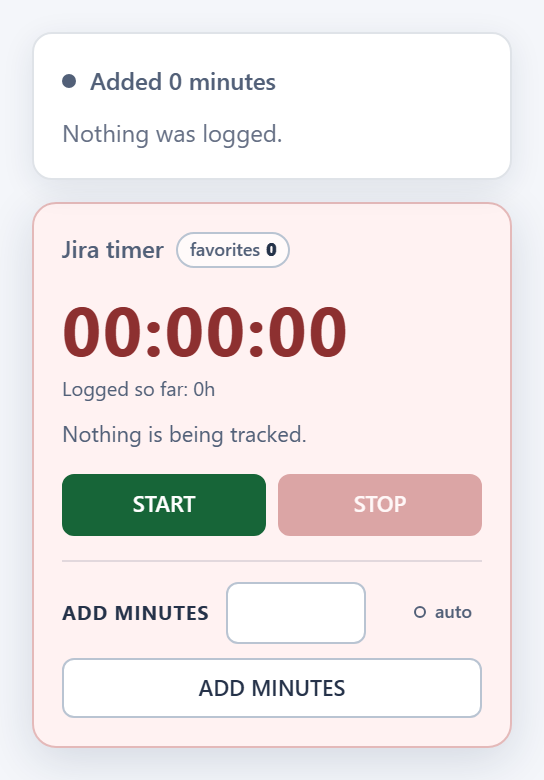
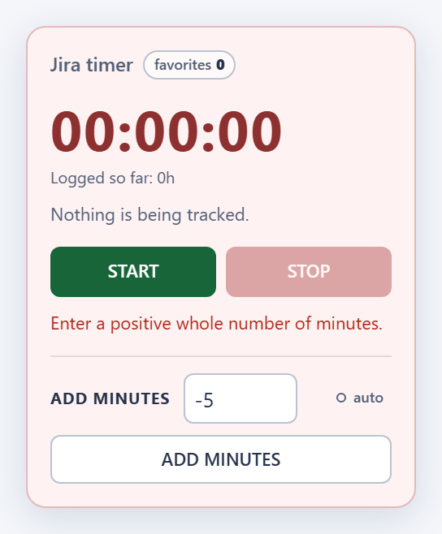

# Jira Local Workspace - Worklog timer v1.18.1

## Changes

- Zero or blank in ADD MINUTES or favorite `+min` is no longer an error: nothing is logged, the running timer is unchanged, and a brief zero-minutes toast appears. The field clears and the favorite editor closes.
- Invalid values (negative, fractional or text) still report a positive whole-minutes error, but omit the duplicate warning reserved for save failures.

## Screenshots

## Installation / update

Tampermonkey loads updates from `main`. After updating to 1.18.1, refresh Jira. Do not install a second copy or clear site data; existing timer state is preserved.

## Verification

`npm test` passed: syntax, Node regressions, release checks, security audit, Chromium regressions with local mocks and screenshot generation. Tests cover zero, 00 and blank through buttons and Enter, no POST or error, the toast, cleared fields, closed editor, unchanged timer, and invalid or excessive values without a duplicate warning.
