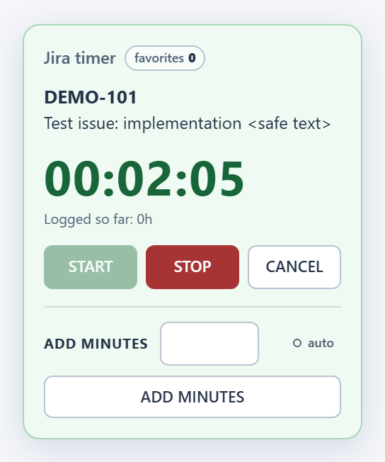

# Jira Local Workspace - Worklog timer v1.18.2

## Changes

- The panel no longer rewrites unchanged text and attributes every 100ms. Instead of roughly 300 DOM mutations per second, only the clock changes once per second, reducing work for Jira observers. Appearance and behavior are unchanged.
- Internal cleanup unified issue key and link handling, minute validation, signed-in user lookup and toast creation.

## Screenshots

## Installation / update

Tampermonkey loads updates from `main`. After updating to 1.18.2, refresh Jira. Do not install a second copy or clear site data; existing timer state is preserved.

## Verification

`npm test` passed: syntax, Node regressions, release checks, security audit, Chromium regressions with local mocks and screenshot generation. A Chromium test verifies unchanged renders produce no DOM mutations other than the clock when idle, running, tracking another issue, corrupted or showing favorites.
