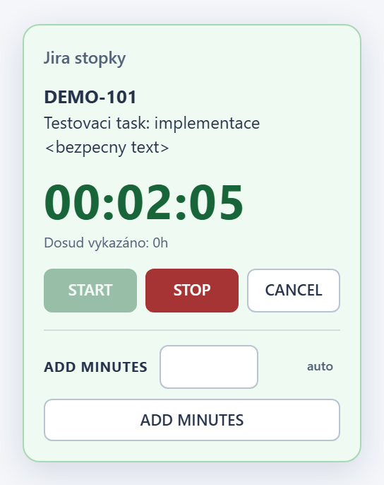
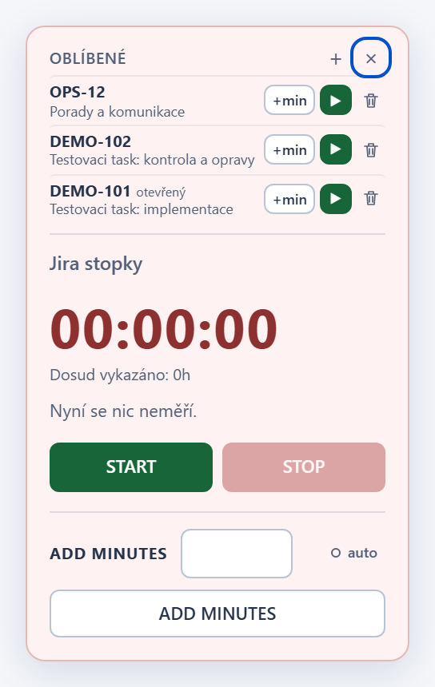

# Jira Local Workspace - Worklog timer v1.18.2

## Changes

- Panel uz kazdych 100 ms neprepisuje texty a atributy, ktere se nezmenily.
  Misto priblizne 300 zmen DOM za sekundu ted zmeni jen hodiny (1x za
  sekundu), takze stopky mene zatezuji Jiru a jeji skripty sledujici
  zmeny stranky. Vzhled ani chovani panelu se nemeni.
- Vnitrni uklid kodu: sjednocena kontrola klice issue, odkazu do Jiry,
  validace minut, nacteni prihlaseneho uzivatele a tvorby toastu.

## Screenshots

Vzhled je beze zmeny; screenshoty jsou pro kontrolu vygenerovane z teto verze.

## Installation / update

Tampermonkey nacita aktualizace z vetve `main`. Po aktualizaci na 1.18.2
obnov stranku Jiry. Neinstaluj druhou kopii skriptu a nemaz data webu;
stav mereni, nastaveni AUTO i oblibene zustavaji zachovany.

## Verification

`npm test`: uspesne kontroly syntaxe, Node regrese, kontroly vydani,
bezpecnostni audit, vsechny Chromium regrese s lokalnimi mocky a
regenerace screenshotu. Novy Chromium test overuje, ze opakovany render
bez zmeny stavu nevytvori zadnou DOM mutaci (mimo hodiny) v klidu, pri
behu, pri mereni jineho tasku, pri poskozenem stavu i s otevrenymi
Oblibenymi.
