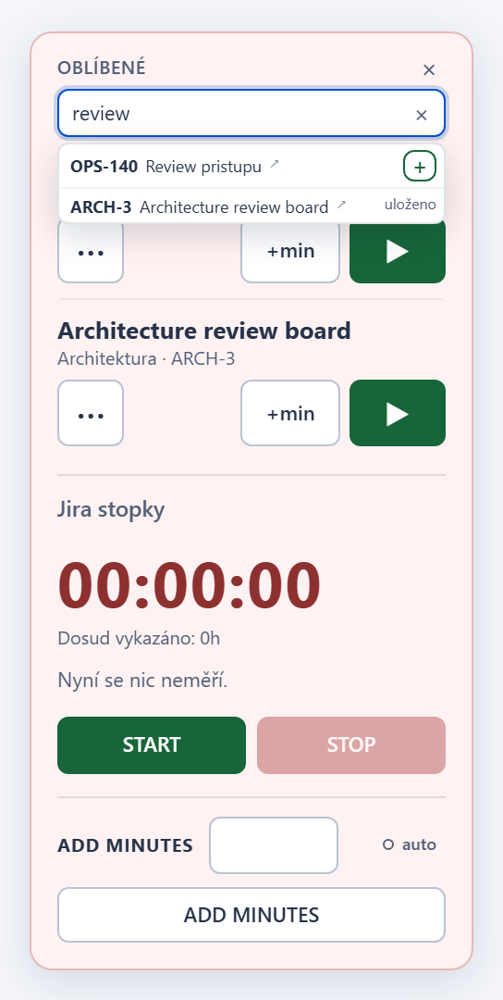
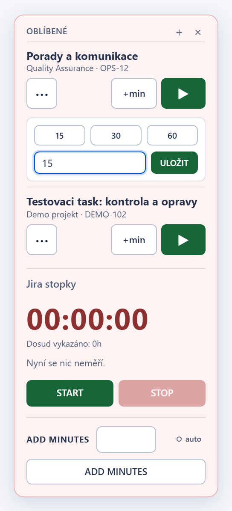

# Jira Local Workspace - Worklog timer v1.18.3

## Changes

- Removed the count from the favorites section heading; the chip retains it.
- Search results float over the list and timer instead of moving the search field or panel. The favorites list remains visible.
- The search field close button and Escape close only search, leaving favorites open.
- The `+min` editor has equal-width 15/30/60 buttons, aligned input and Save, no number spinners or duplicated label, improved spacing and a subtler focus indicator.

## Screenshots

## Installation / update

Tampermonkey loads updates from `main`. After updating to 1.18.3, refresh Jira. Do not install a second copy or clear site data; existing timer state is preserved.

## Verification

`npm test` passed: syntax, Node regressions, release checks, security audit, Chromium regressions with local mocks and screenshot generation. New tests verify that search and panel remain stationary, the list stays visible and the search close button closes only search.
