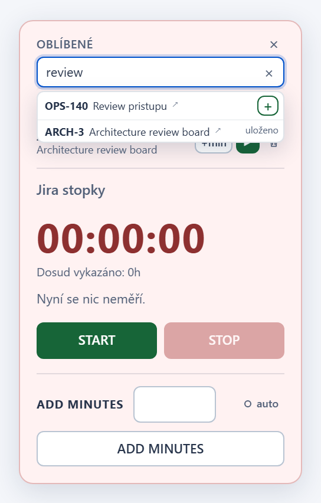
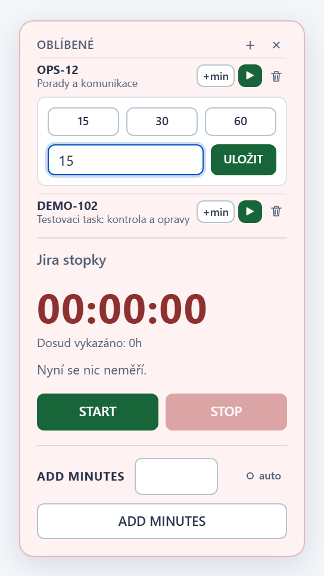
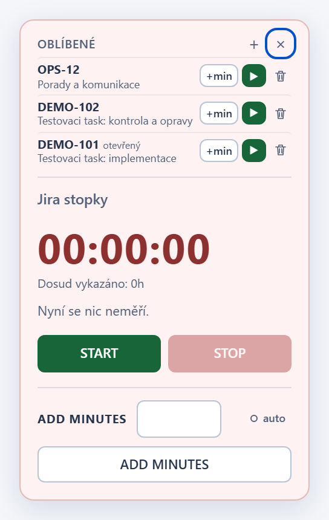

# Jira Local Workspace - Worklog timer v1.18.3

## Changes

- Oblibene: z nadpisu sekce zmizel pocet tasku (pocet zustava jen na
  stitku `oblibene N`).
- Hledani uz neposkakuje: vysledky se zobrazuji jako plovouci nabidka pod
  polem pres seznam a stopky, takze se pole ani panel pri psani nehybou.
  Seznam oblibenych zustava pod nabidkou na svem miste.
- Pole hledani ma vlastni krizek, ktery zavre jen hledani (Oblibene zustanou
  otevrene); stejne funguje Escape.
- Editor `+min` je prehlednejsi: rychle volby 15/30/60 ve stejne sirokych
  tlacitkach, pod nimi pole a ULOZIT ve stejne vysce, bez sipek a bez
  zdvojeneho popisku, s vetsimi odsazenimi a jemnejsim zvyraznenim fokusu.

## Screenshots

## Installation / update

Tampermonkey nacita aktualizace z vetve `main`. Po aktualizaci na 1.18.3
obnov stranku Jiry. Neinstaluj druhou kopii skriptu a nemaz data webu;
stav mereni, nastaveni AUTO i oblibene zustavaji zachovany.

## Verification

`npm test`: uspesne kontroly syntaxe, Node regrese, kontroly vydani,
bezpecnostni audit, vsechny Chromium regrese s lokalnimi mocky a
regenerace screenshotu. Nove testy overuji, ze se pole hledani ani panel
pri zobrazeni vysledku neposunou, ze seznam zustava viditelny a ze krizek
v poli zavre jen hledani.
