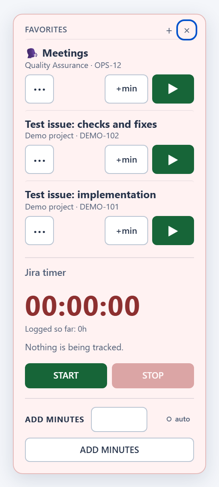

# Jira Local Workspace - Worklog timer v1.18.4

## Changes

- Removed the extra label on the currently open favorite. Only timer-relevant indicators remain, such as the blue dot and `■` for a running timer.

## Screenshots

## Installation / update

Tampermonkey loads updates from `main`. After updating to 1.18.4, refresh Jira. Do not install a second copy or clear site data; existing timer state is preserved.

## Verification

`npm test` passed: syntax, Node regressions, release checks, security audit, Chromium regressions with local mocks and screenshot generation. A regression checks that the current favorite has no extra label.
