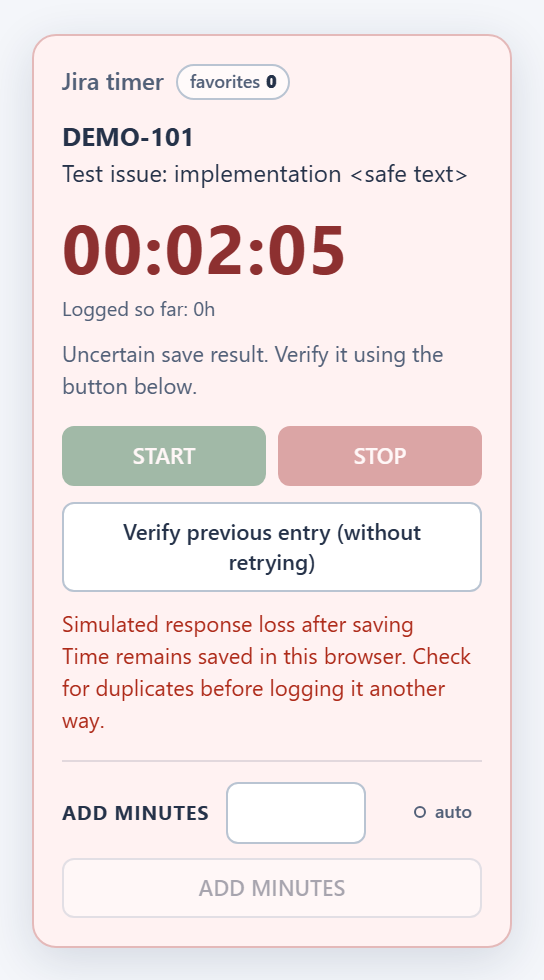
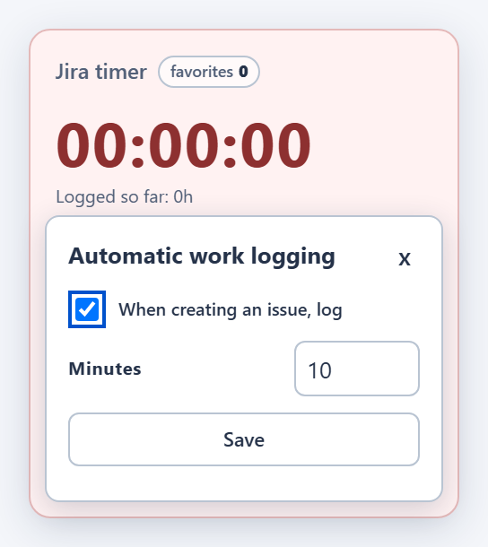
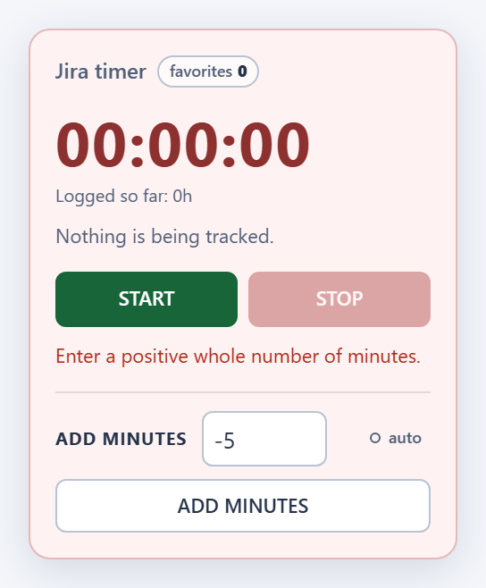
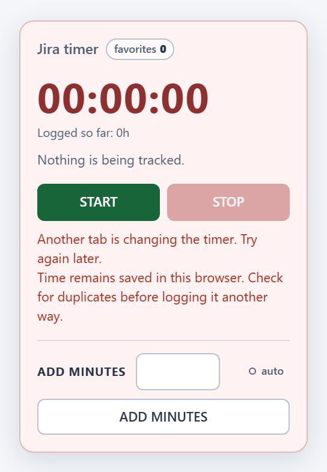
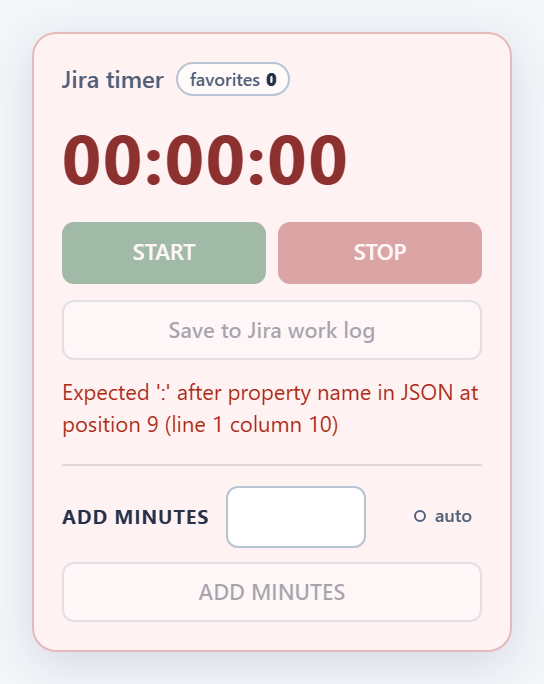

# Jira Local Workspace - Worklog timer v1.18.5

## Changes

- Fixed missing Czech diacritics in the timer's loading status (#35).
- Reviewed and corrected the other panel labels and states, including save and verification buttons, stopped status, AUTO settings, lock errors, corrupted state, Jira responses and minute validation.
- New Jira work log comments also received corrected diacritics. Uncertain-write recovery still searches only for the `[jira-direct-timer:<id>]` marker, so older work logs remain recognizable.

## Screenshots

## Installation / update

Tampermonkey loads updates from `main`. After updating to 1.18.5, refresh Jira. Do not install a second copy or clear site data; existing timer state is preserved.

## Verification

`npm test` passed: syntax, Node regressions, release checks, security audit, Chromium regressions with local mocks and screenshot generation. A new regression checked the loading text and guarded against missing diacritics.
