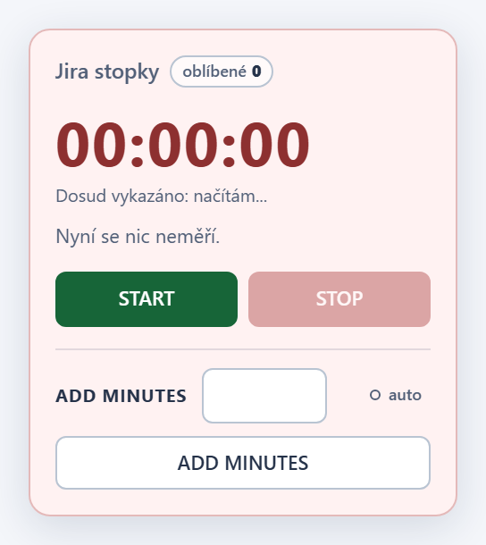
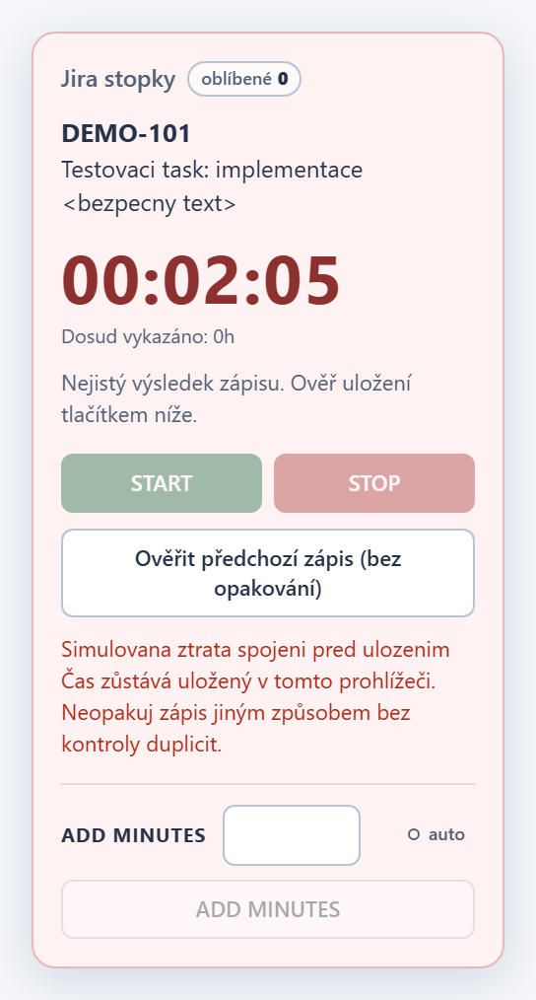

# Jira Local Workspace - Worklog timer v1.18.5

## Changes

- Opravena chybejici diakritika v textech stopek (#35): stav souctu nyni
  zobrazuje `Dosud vykazáno: načítám...` misto `nacítám`.
- Projity a opraveny i ostatni stavy a texty panelu, ktere byly bez hacku a
  carek: tlacitka `Uložit do Jira worklogu` a `Ověřit předchozí zápis`,
  stav `Zastaveno, zatím neuloženo`, nastaveni AUTO, chyby zamku, poskozeneho
  stavu, Jira odpovedi i validace minut.
- Komentare novych worklogu zapisovanych do Jiry maji take diakritiku
  (`Práce na úkolu`, `Ruční výkaz`, `Automatický výkaz`). Obnova po
  nejistem zapisu dal hleda jen marker `[jira-direct-timer:<id>]`, takze
  starsi worklogy zustavaji rozpoznane.

## Screenshots

## Installation / update

Tampermonkey nacita aktualizace z vetve `main`. Po aktualizaci na 1.18.5
obnov stranku Jiry. Neinstaluj druhou kopii skriptu a nemaz data webu;
stav mereni, nastaveni AUTO i oblibene zustavaji zachovany.

## Verification

`npm test`: uspesne kontroly syntaxe, Node regrese, kontroly vydani,
bezpecnostni audit, vsechny Chromium regrese s lokalnimi mocky a
regenerace screenshotu. Nova regrese overuje text `načítám` pri nacitani
souctu a hlida, aby se do skriptu nevratily texty bez diakritiky.
