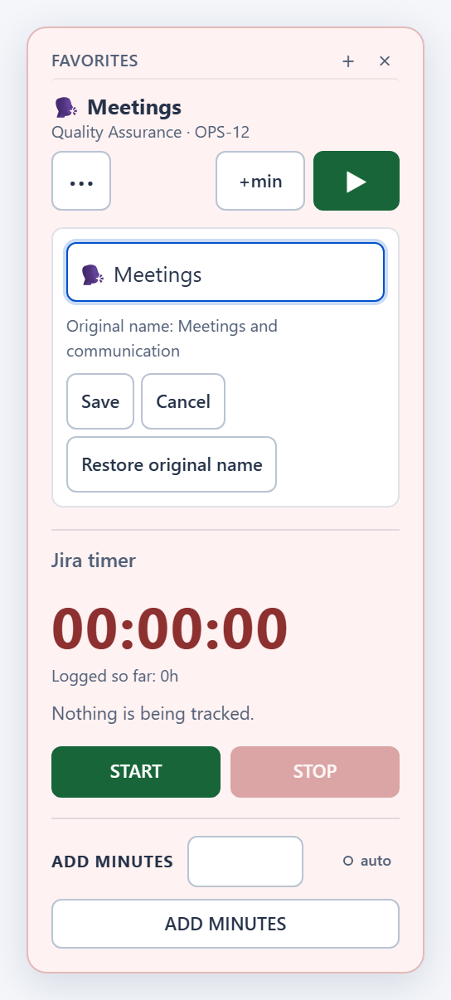

# Jira Local Workspace - Worklog timer v1.19.0

## Changes

- Favorites prominently display the title, with project name and key underneath. If the project cannot be loaded, the key is shown and the menu offers a retry.
- The `⋯` menu supports a custom name including emoji, restoring the original, and removing the favorite. Renaming is local to favorites and does not change Jira.
- Start, stop and add-minutes buttons are larger, with start remaining the most prominent action.

## Screenshots

## Installation / update

Tampermonkey loads updates from `main`. After updating to 1.19.0, refresh Jira. Do not install a second copy or clear site data; existing timer state is preserved.

## Verification

`npm test` passed: syntax, Node regressions, release checks, security audit, Chromium regressions with local mocks and screenshot generation.
