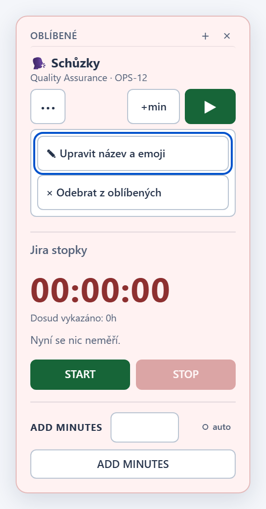

# Jira Local Workspace - Worklog timer v1.19.0

## Changes

- Oblíbené tasky zobrazují výrazně název a pod ním název projektu a klíč.
  Pokud se projekt nepodaří načíst, zobrazí se jeho klíč a nabídka umožní
  načtení zopakovat.
- V nabídce `⋯` lze nastavit vlastní název včetně emoji, obnovit původní
  název nebo task odebrat. Přejmenování platí jen v oblíbených, ne v Jiře.
- Tlačítka pro spuštění, zastavení a přidání minut jsou větší; spuštění
  zůstává nejvýraznější akcí.

## Screenshots

## Installation / update

Tampermonkey načítá aktualizace z větve `main`. Po aktualizaci na 1.19.0
obnov stránku Jiry. Neinstaluj druhou kopii skriptu ani nemaž data webu.

## Verification

`npm test`: kontrola syntaxe, Node regrese, kontroly vydání, bezpečnostní
audit, Chromium regrese s lokálními mocky a regenerace screenshotů.
