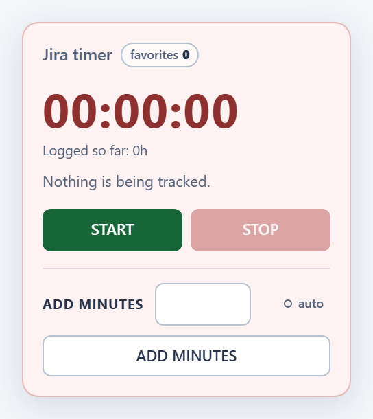
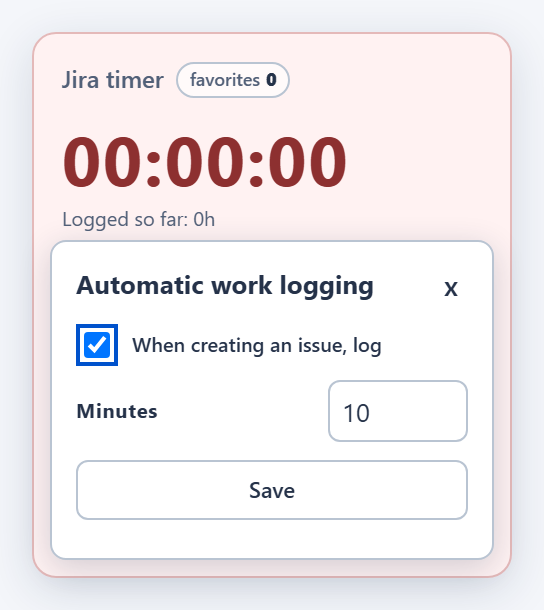
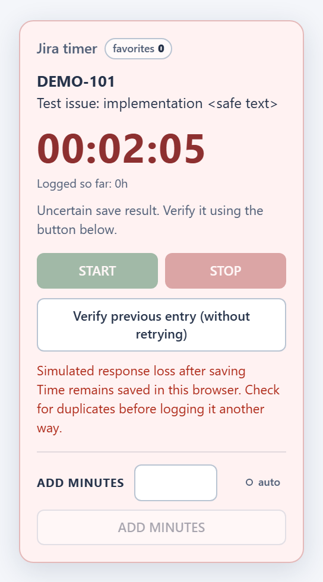
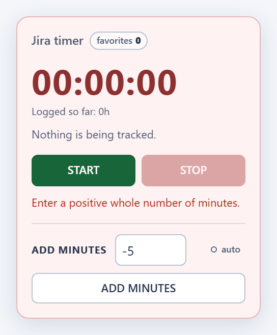

# Jira Local Workspace - Worklog timer v1.20.0

## Changes

- The timer, accessibility labels, errors, confirmations and new work log
  comments are now in English. Logged hours use an English decimal point.
- Documentation, the local playground, regression scenarios and historical
  release notes are translated into English.
- Existing timers, favorites, AUTO settings and work log markers remain
  compatible. Uncertain writes are still verified without automatic retries.

## Screenshots

## Installation / update

Tampermonkey loads updates from `main`. After updating to 1.20.0, refresh Jira.
Do not install a second copy or clear site data; existing timer state,
favorites and AUTO settings are preserved.

## Verification

`npm test` passed: production syntax checks, Node regressions, release checks,
the security audit, 46 Chromium regressions with local mocks, and 28 screenshot
states. Responsive layout was checked at normal and narrow viewport widths.
`npm audit --audit-level=high` found no vulnerabilities.
